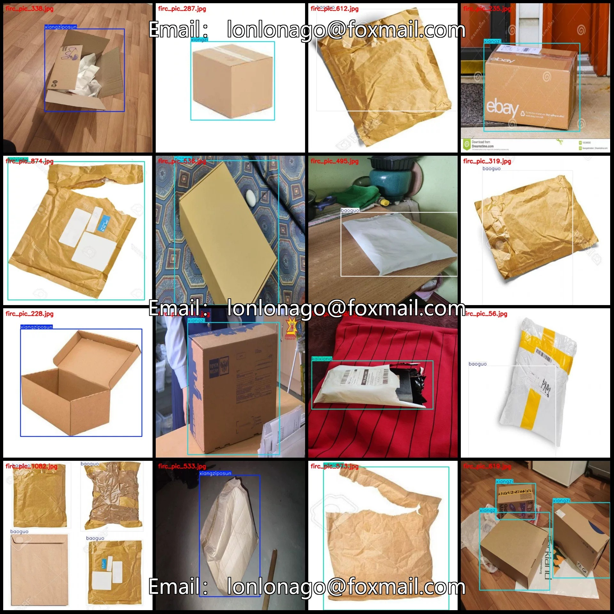
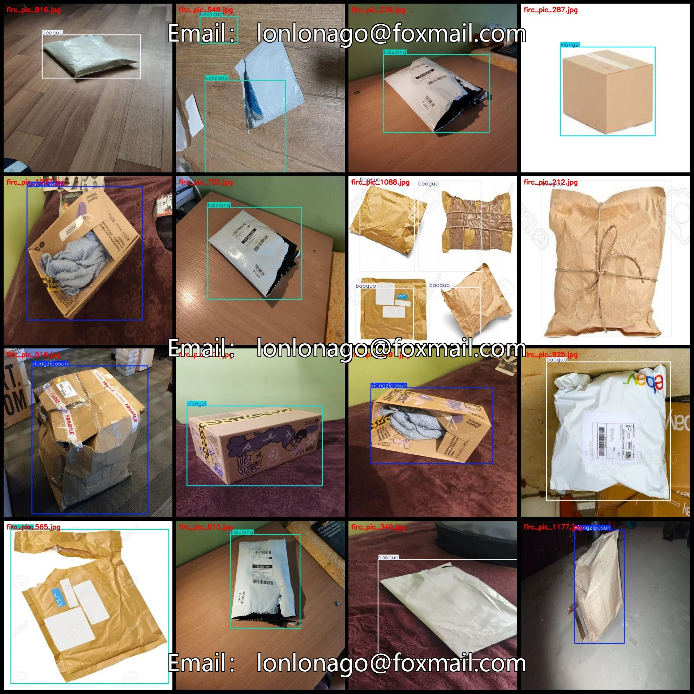
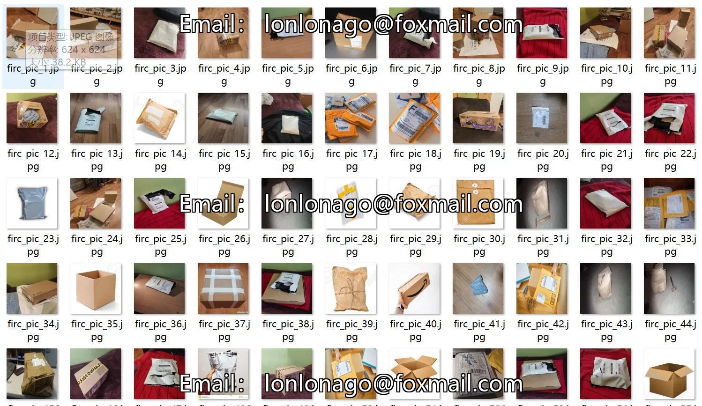
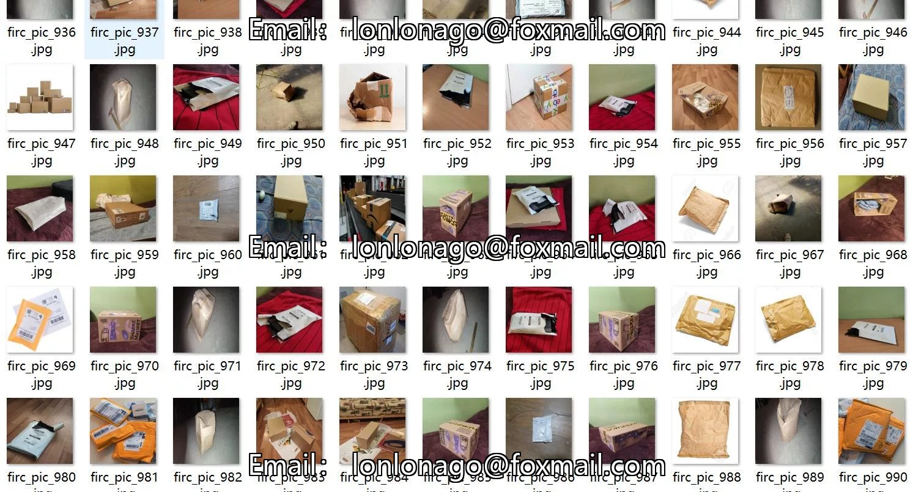
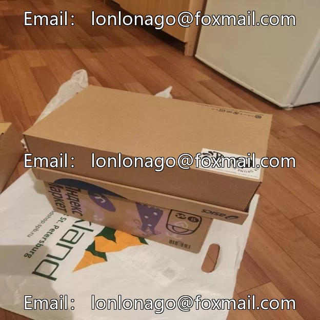
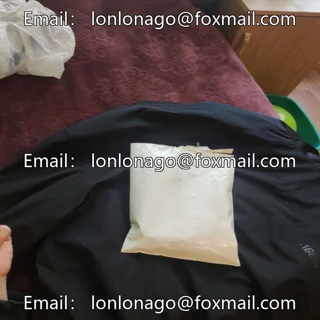
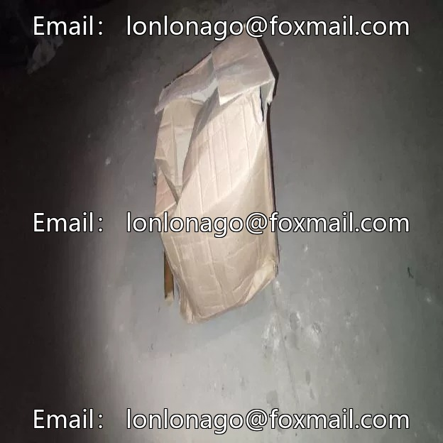

# Intelligent logistics express parcel damage detection dataset VOC+YOLO format 1200 images

## Body

Smart Logistics Express Parcel Damage Detection Dataset VOC+YOLO Format: 1200 Images in 4 Categories
Warm Reminder: Due to the dataset's replicability, please confirm compliance with requirements before purchasing.
Dataset format: Pascal VOC format + YOLO format (txt files without split paths, only containing jpg images and corresponding VOC format xml files and yolo format txt files)
Number of images (number of jpg files): 1200
Number of annotations (number of xml files): 1200
Number of annotations (number of txt files): 1200
Number of annotation categories: 4

Label category names (Note that the order of categories in the YOLO format does not correspond to this, but is based on the classes.txt file in the labels folder): ["baoguo", "kaixiang", "xiangzi", "xiangziposun"]
["Package", "Unboxing", "Box", "Broken Box"]
Number of boxes and the number of images occupied by each category
Baoguo Frames = 432, Pictures Taken = 300
Kaixiang frame count = 308, occupying image count = 302
Xiangzi frame count = 448, occupying picture count = 303

Xiangziposun Frames = 304, occupied Image Count = 302
Total Frames: 1492
Image Resolution: 624x624
Labeling Tool: labelImg
Labeling Rules: Draw a rectangle around the category.
Important Notice: The dataset does not have split into training, validation, and test sets; you need to do this yourself.
Special Remark: This dataset does not guarantee the accuracy of the trained model or weight files.

## Images

## Payment

Here is a pay link on Stripe ( https://buy.stripe.com/3cs8yP7sY87d0vu9AB ). Please contact me lonlonago@foxmail.com after funding $89, and I will send you a complete data files , thank you!

